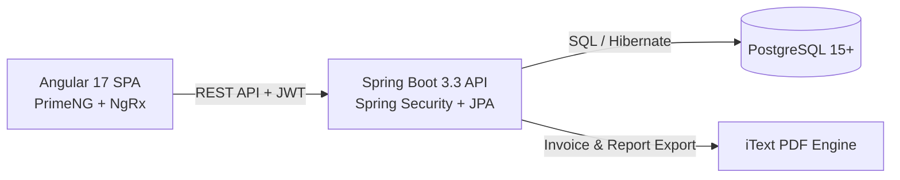
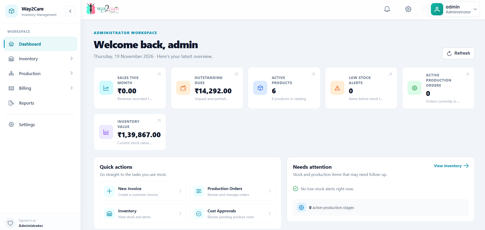
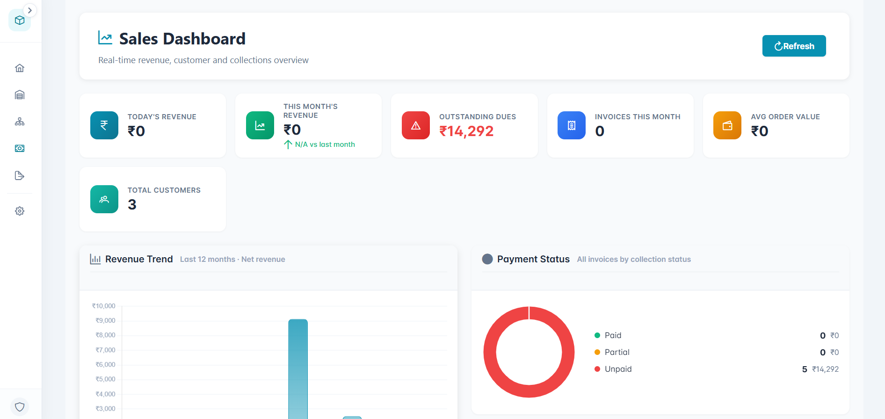
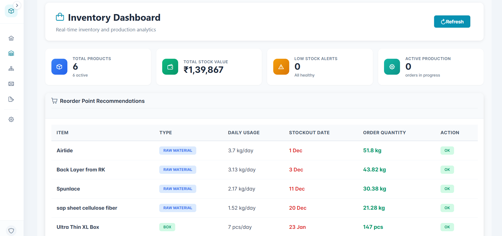
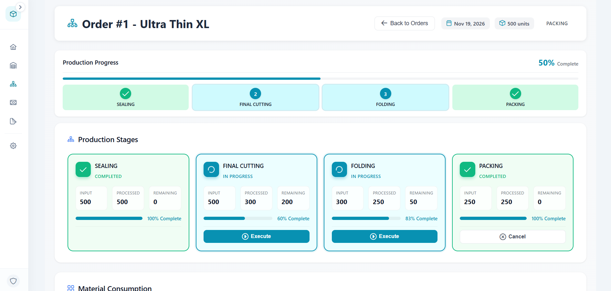
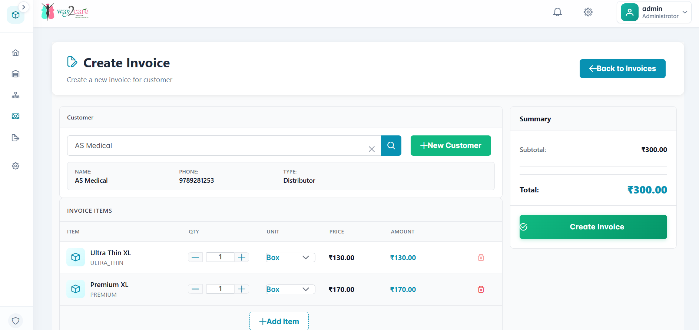
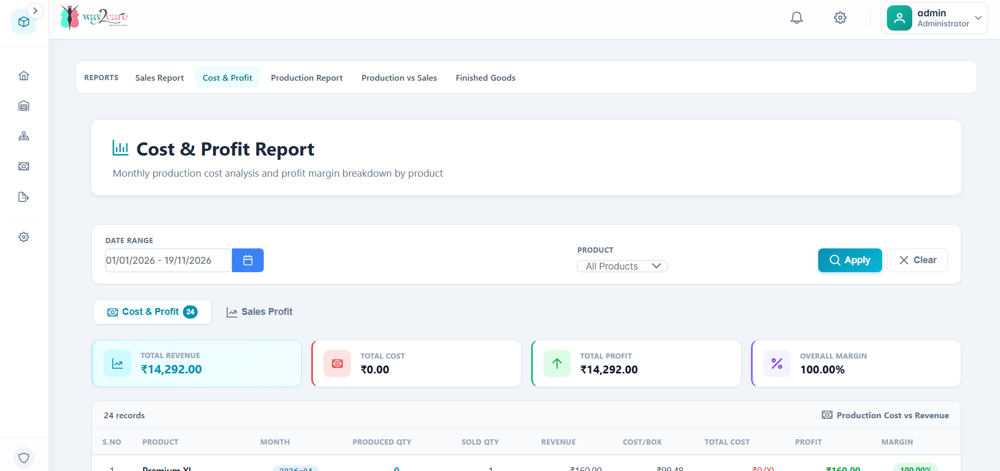
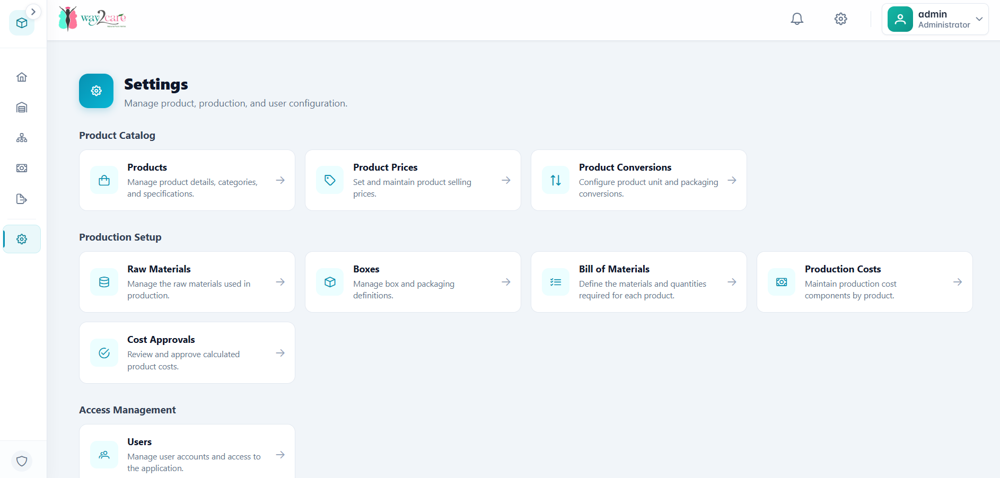

# Way2Care Inventory Management

Way2Care Inventory Management is a full-stack enterprise web application for managing products, raw materials, bills of materials (BOM), production orders, customer billing, cost approvals, and business analytics. It enforces role-based access control (RBAC) across both the frontend and backend so each user only accesses the screens and operations relevant to their role.

> **Detailed Technical Docs:** For in-depth architecture, module breakdowns, and design details, see [PROJECT_DOCUMENTATION.md](./PROJECT_DOCUMENTATION.md).

## Table of Contents

- [Key Features](#key-features)
- [Roles & Permissions](#roles--permissions)
- [System Architecture](#system-architecture)
- [Tech Stack](#tech-stack)
- [Engineering Highlights](#engineering-highlights)
- [Screenshots](#screenshots)
- [Project Structure](#project-structure)
- [Getting Started (Run Locally)](#getting-started-run-locally)
- [Build & Testing](#build--testing)
- [Configuration & Security](#configuration--security)
- [Troubleshooting](#troubleshooting)
- [Roadmap](#roadmap)

## Key Features

- **Product & Materials Management:** Manage finished products, raw materials, packaging materials, multi-component Bills of Materials (BOM), and product pricing.
- **Inventory Tracking:** Monitor real-time stock levels across raw materials, packaging boxes, and finished goods with automated low-stock alerts.
- **Production Management:** Create, track, and update production orders with raw-material stock consumption and finished-goods updates.
- **Billing & Invoicing:** Manage customer records, generate PDF invoices, record partial or full payments, apply active discount rules, and track outstanding balances.
- **Cost Management & Approval Workflow:** Calculate total product costs across materials, production, and packaging; submit proposed cost changes for administrative review and approval.
- **Dashboards & Reporting:** View sales, inventory, production, cost, and profit dashboards with downloadable PDF and business report exports.
- **Role-Based Access Control (RBAC):** Protect API endpoints and Angular routes according to the signed-in user's assigned role.

## Roles & Permissions

| Role | Access Scope |
| --- | --- |
| **Admin** | System settings, user management, products, inventory, production, billing, cost approvals, and all dashboards/reports |
| **Accountant** | Customers, invoices, payments, sales dashboard, and sales reports |
| **Production Manager** | Production orders, inventory, raw materials, finished goods, and production reports |

## System Architecture



## Tech Stack

| Layer | Technologies |
| --- | --- |
| **Frontend** | Angular 17, TypeScript, PrimeNG, NgRx |
| **Backend** | Java 17, Spring Boot 3.3, Spring Data JPA, Spring Security, JWT |
| **Database** | PostgreSQL 15+ |
| **PDF Reporting** | iText |
| **Testing** | JUnit 5, Mockito, Karma/Jasmine |

## Engineering Highlights

- **Stateless Security & First-Run Admin Bootstrapping:** Implemented JWT-based authentication, RBAC via Spring Security, and zero-hardcoded-credential bootstrapping that seeds an initial BCrypt-encoded Admin on an empty database with a mandatory first-login password change.
- **Complex Manufacturing & Costing Workflows:** Modeled Bills of Materials (BOM), dynamic discount calculations, production stock movements, and multi-step cost-change approval logic.
- **Scalable State Management:** Structured the Angular 17 frontend using NgRx for predictable global state management alongside PrimeNG enterprise data tables and dashboards.
- **Automated Document Generation & Test Coverage:** Integrated iText for dynamic PDF invoicing/reporting and wrote isolated unit tests using JUnit 5 and Mockito across core business services.

## Screenshots

### Landing Page


### Dashboards

| Sales Dashboard | Inventory Dashboard |
| --- | --- |
|  |  |

### Operations & Billing

| Production Orders | Billing & Invoicing |
| --- | --- |
|  |  |

### Reports & Administration

| Business Reports | System Settings |
| --- | --- |
|  |  |

## Project Structure

```text
.
├── .github/                      # GitHub workflows / repository configuration
├── backend/
│   └── inventory-management/     # Spring Boot 3.3 REST API (Maven Wrapper)
├── frontend/
│   └── inventory/                # Angular 17 SPA (NgRx + PrimeNG)
├── .env.example                  # Sample environment variable template
├── .gitignore                    # Git exclusion rules
├── docker-compose.yml            # Container orchestration template (in progress)
├── PROJECT_DOCUMENTATION.md      # Full technical & functional documentation
└── README.md                     # Project overview and setup guide
```

## Getting Started (Run Locally)

### Prerequisites

- **Java 17** or newer
- **Node.js** `18.13+` or `20.9+` (with `npm`)
- **PostgreSQL 15+**

### 1. Prepare PostgreSQL & Environment Variables

Create a local PostgreSQL database named `inventory`. Never commit real credentials or signing keys to source control.

Set the environment variables for your operating system. On Windows, use the PowerShell commands below in the same terminal that will start the backend.

#### Windows PowerShell

```powershell
$env:SPRING_DATASOURCE_URL = "jdbc:postgresql://localhost:5432/inventory"
$env:SPRING_DATASOURCE_USERNAME = "postgres"

$secureDbPassword = Read-Host "Local PostgreSQL password" -AsSecureString
$dbPasswordPointer = [Runtime.InteropServices.Marshal]::SecureStringToBSTR($secureDbPassword)
try {
    $env:SPRING_DATASOURCE_PASSWORD = [Runtime.InteropServices.Marshal]::PtrToStringBSTR($dbPasswordPointer)
} finally {
    [Runtime.InteropServices.Marshal]::ZeroFreeBSTR($dbPasswordPointer)
}

$env:INITIAL_ADMIN_USERNAME = "admin"
$secureAdminPassword = Read-Host "Initial admin password" -AsSecureString
$adminPasswordPointer = [Runtime.InteropServices.Marshal]::SecureStringToBSTR($secureAdminPassword)
try {
    $env:INITIAL_ADMIN_PASSWORD = [Runtime.InteropServices.Marshal]::PtrToStringBSTR($adminPasswordPointer)
} finally {
    [Runtime.InteropServices.Marshal]::ZeroFreeBSTR($adminPasswordPointer)
}

$bytes = New-Object byte[] 32
$rng = [System.Security.Cryptography.RandomNumberGenerator]::Create()
$rng.GetBytes($bytes)
$env:JWT_SECRET = [Convert]::ToBase64String($bytes)
$rng.Dispose()
```

#### macOS / Linux (Bash / Zsh)

```bash
export SPRING_DATASOURCE_URL="jdbc:postgresql://localhost:5432/inventory"
export SPRING_DATASOURCE_USERNAME="postgres"
export SPRING_DATASOURCE_PASSWORD="your-local-postgres-password"
export INITIAL_ADMIN_USERNAME="admin"
export INITIAL_ADMIN_PASSWORD="your-initial-admin-password"
export JWT_SECRET=$(openssl rand -base64 32)
```

> **How Initial Admin Bootstrapping Works:**
>
> * On an **empty database**, the backend creates the initial Admin account with a BCrypt-encoded password using `INITIAL_ADMIN_USERNAME` and `INITIAL_ADMIN_PASSWORD`.
> * Once **any user exists** in the database, this bootstrap step is automatically skipped.
> * Environment variables set above apply only to the current terminal session. The backend uses Hibernate schema auto-update during local development; review DDL settings and transition to managed migrations (e.g., Flyway or Liquibase) before production deployment.

### 2. Start the Backend

From the project root in the **same terminal window** where you set the environment variables:

```powershell
Set-Location .\backend\inventory-management
.\mvnw.cmd spring-boot:run
```

```bash
# macOS / Linux
cd backend/inventory-management
./mvnw spring-boot:run
```

The REST API will listen at `http://localhost:9090/inventory`. Keep this terminal open while using the application.

### 3. Start the Frontend

Open a **second terminal window** at the project root:

```powershell
Set-Location .\frontend\inventory
npm ci
node .\node_modules\@angular\cli\bin\ng.js serve
```

```bash
# macOS / Linux
cd frontend/inventory
npm ci
npx ng serve
```

Open `http://localhost:4200` in your browser. The development frontend targets `http://localhost:9090/inventory` by default—update `frontend/inventory/src/environments/environment.ts` if your backend runs on a different host or port.

### 4. First-Time Sign In

- **Empty database:** Sign in with the `INITIAL_ADMIN_USERNAME` and `INITIAL_ADMIN_PASSWORD` you configured above. You will be prompted to change the password immediately after logging in. Afterward, use the **Users** page to create accounts for additional roles (Accountant, Production Manager, etc.).
- **Existing database:** Sign in with an existing account; the bootstrap environment variables are no longer required and should be removed from your environment or deployment settings.

## Build & Testing

### Backend Unit Tests

The backend test suite uses **JUnit 5** and **Mockito** to validate billing and payments, login/logout flows, cost approvals, production orders, raw-material stock updates, and discount calculations. Repositories are mocked, so PostgreSQL does not need to be running.

Run all backend unit tests from `backend/inventory-management`:

```powershell
.\mvnw.cmd test
```

```bash
# macOS / Linux
./mvnw test
```

Run a specific test class:

```powershell
.\mvnw.cmd '-Dtest=DiscountCalculationServiceImplTest' test
```

Run a single test method:

```powershell
.\mvnw.cmd '-Dtest=DiscountCalculationServiceImplTest#calculateDiscountReturnsZeroWhenThereAreNoActiveOffers' test
```

Maven prints a summary to the terminal and writes detailed reports to `backend/inventory-management/target/surefire-reports`.

### Frontend Build & Tests

From `frontend/inventory`, use these commands in PowerShell:

```powershell
node .\node_modules\@angular\cli\bin\ng.js build
node .\node_modules\@angular\cli\bin\ng.js test
```

## Configuration & Security

- **JWT Authentication:** All protected API endpoints require a valid signed JWT bearer token issued upon login.
- **Secure Admin Bootstrapping:** No default credentials are hardcoded. Initial admin credentials are supplied via environment variables only for a fresh database, stored with BCrypt hashing, and require a password reset on first login. Remove bootstrap credentials once the initial admin exists.
- **Secret Management:** Database credentials and JWT signing keys are supplied exclusively through environment variables. `.env.example` contains placeholders only; local `.env` files are excluded via `.gitignore`.
- **Environment Separation:** Update `frontend/inventory/src/environments/` when targeting staging or production APIs.
- **Database Migrations:** Review Hibernate auto-DDL settings before production deployment and transition to managed schema migrations.

## Troubleshooting

| Issue | Resolution |
| --- | --- |
| **Backend cannot connect to PostgreSQL** | Confirm PostgreSQL is running, the `inventory` database exists, and the environment variables are set in the same terminal window where you run Maven. |
| **Frontend cannot reach the API** | Confirm the backend is running on port `9090` and verify the API base URL in `frontend/inventory/src/environments/environment.ts`. |
| **401 Unauthorized / 403 Forbidden** | Sign in again to refresh your JWT token and verify your user account holds the required role for the requested screen or endpoint. |
| **Maven reports a resource file is in use** | Stop any running Spring Boot process locking files inside `target/`, then re-run the test command. |
| **Angular CLI fails on Windows paths containing `&`** | Run Angular directly via Node from `frontend/inventory`: `node .\node_modules\@angular\cli\bin\ng.js serve` (or `build` / `test`). |

## Roadmap

- Add backend and frontend `Dockerfile` configurations to enable one-command containerized startup via `docker-compose up`.
- Integrate Flyway for versioned database schema migrations.
- Expand automated CI checks in `.github/` for backend tests and frontend production builds.